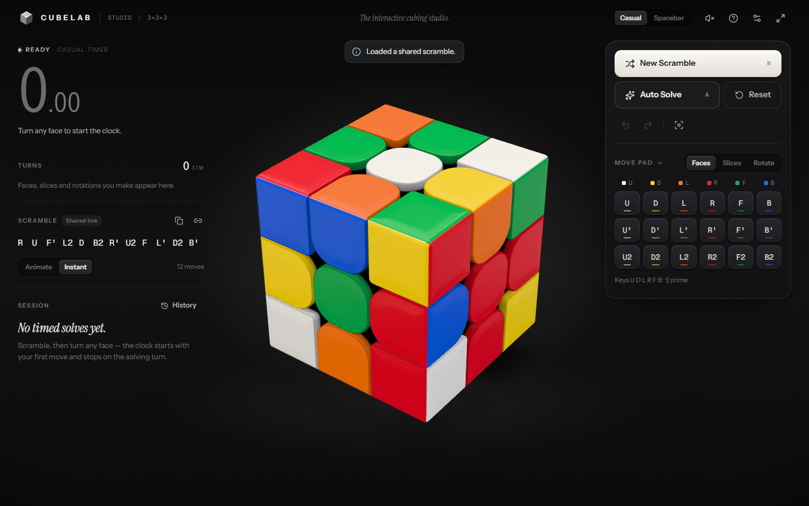
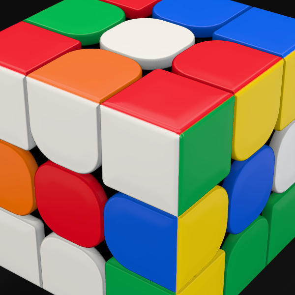
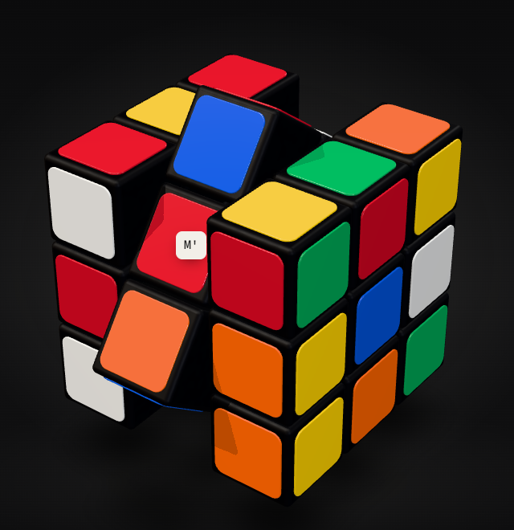
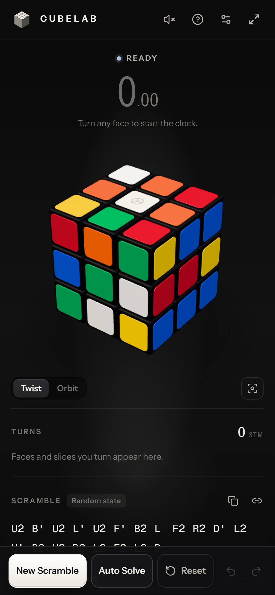
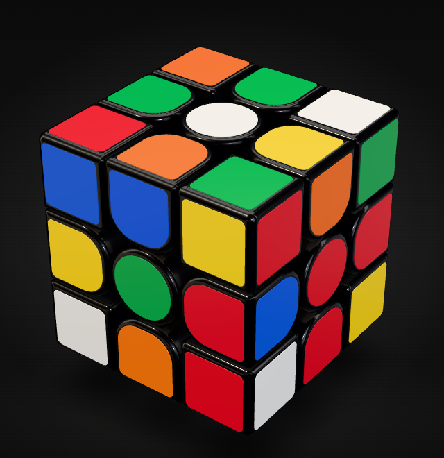
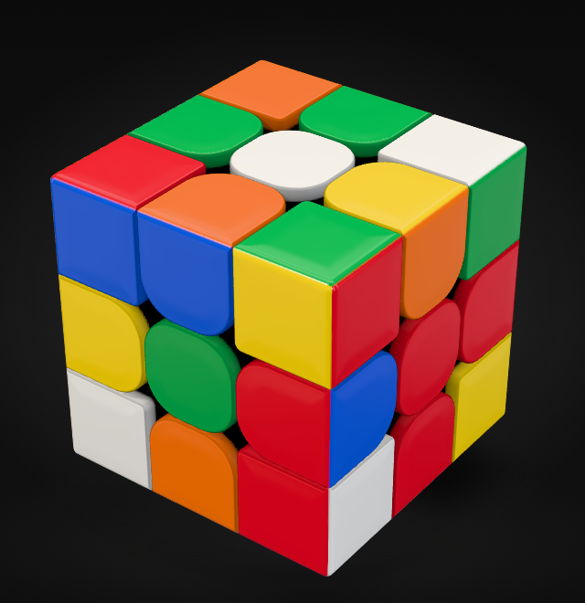

# CUBELAB

**The interactive cubing studio.** The original photoreal 3×3×3 remains the full-featured studio:
stickerless or stickered, face and M/E/S slice turns, WCA-style random-state practice scrambles,
timing, and move-by-move solve playback. The puzzle selector now adds playable stickerless 2×2,
4×4, 5×5, 6×6, and 7×7 cubes with their own scrambles, timers, and solve histories. Pyraminx
and Skewb also have playable 3D puzzle views, event scrambles, and separate timing histories.

Everything runs locally in the browser. There are no accounts, no servers, no analytics; solves and
settings live in this browser's `localStorage` only.



| Close-up | Mid-turn M slice | Phone |
| --- | --- | --- |
|  |  |  |

## Quick start

Requires Node.js ≥ 22.3 (cubing.js needs `process.getBuiltinModule`).

```bash
npm install
```

```bash
npm run dev          # http://localhost:5317
```

```bash
npm run build        # typecheck + production bundle in dist/
```

```bash
npm run preview      # serves dist/ at http://localhost:4317
```

```bash
npm test             # Vitest suite (real cubing.js scrambler and solver, nothing mocked)
```

```bash
npm run test:e2e     # Playwright against the production build (builds + previews automatically)
```

| Script                | Purpose                                                                         |
| --------------------- | ------------------------------------------------------------------------------- |
| `npm run dev`         | Vite dev server on port 5317                                                    |
| `npm run build`       | `tsc -b` then `vite build`                                                      |
| `npm run preview`     | Serve the production build on port 4317                                         |
| `npm run typecheck`   | Strict TypeScript project build                                                 |
| `npm run lint`        | ESLint (typescript-eslint + React Compiler hook rules)                          |
| `npm test`            | Vitest suite                                                                    |
| `npm run test:e2e`    | Playwright: Chromium desktop 1440×900, Chromium phone 390×844 (touch), Firefox and WebKit smoke |
| `npm run test:all`    | Everything above, in order                                                      |
| `npm run screenshots` | Re-capture `artifacts/after/*.png` (needs `npm run preview` running)             |
| `node scripts/capture-style-matrix.mjs` | Both cube styles side by side → `artifacts/styles/` (needs preview) |
| `node scripts/capture-style-previews.mjs` | Re-render the Settings previews in `src/assets/cube-styles/` (needs preview) |
| `node scripts/render-audio-demo.mjs` | Render the turn-sound demonstration to `artifacts/audio/turn-demo.wav` (needs preview) |

First Playwright run on a new machine: `npx playwright install chromium firefox webkit`.

## Using the studio

### Choosing a puzzle

Use the puzzle selector in the top bar. The 3×3 keeps its existing solver, playback, styles,
settings, and statistics. The other sizes use a shared exact-piece model with rounded plastic caps,
a dark internal mechanism, animated turns, and a playable 2D net when WebGL is unavailable.

| Size | Practice features |
| --- | --- |
| 2×2 | Event scramble, timer, undo/redo, local history, verified solution |
| 4×4–7×7 | Event scramble, outer and wide turns, timer, undo/redo, local history |
| Pyraminx | Event scramble, face and tip turns, timer, local history |
| Skewb | Event scramble, corner-axis turns, timer, local history |

In these new modes, tap a coloured face to turn it, drag a sticker along a row or column to turn
that layer, or use the face buttons and keyboard (`U R F D L B`; hold Shift for inverse). Drag the
background to orbit. For larger cubes, choose **Outer**, **Wide 2**, or **Wide 3** where available.
The first turn after a scramble starts the timer; solving stops it. Undo and redo mark an attempt
as practice, so it cannot become a clean best single. Results are stored separately for each size.
The **Find Solution** button on 2×2 verifies the returned algorithm against the physical model
before offering to apply it; applying it never creates a timed result.

The non-3×3 cube modes also accept physical-cube times. Their result rows let you correct a
penalty or remove a solve, and JSON export/import provides a per-event backup. Pyraminx and
Skewb have shape-specific turn buttons beside their 3D views. Their turns and solved states use
the corresponding puzzle definitions rather than cube geometry.

These are practice scrambles generated locally by cubing.js, not official competition scrambles.

### 3×3 turning and controls

### Turning the cube

- **Twist** — press a sticker and push it along its row or column. The layer under your finger follows
  the drag; release past ~25° (or flick) to commit, otherwise it springs back. A label beside the
  pointer shows the layer you have grabbed, and turns ivory with the exact move (`R`, `M'`, `S2`…) once
  releasing would commit it. With a mouse, a faint outline marks the sticker under the pointer.
- **Middle slices** — the middle row or column turns the middle layer:
  - on the front (or back) face, push the **middle column** up/down for **M**, the **middle row**
    sideways for **E**;
  - on the top, bottom or a side face, push the middle strip that runs between F and B for **S**.
  The centre sticker belongs to both strips, so the direction you drag decides. This works the same
  from any camera angle and with touch.
- **Orbit** — drag the empty background to turn the cube over in any direction, like rolling it in
  your hand: there are no poles, so keep dragging up or down and white ends up facing the floor.
  Right-drag, middle-drag or Shift/Alt/Ctrl-drag orbits from anywhere, including over the cube.
  **Zoom** with the wheel or a pinch (two fingers also orbit). `C` brings the view home.
- **Re-grip** — `X` `Y` `Z` (or the Move Pad's **Rotate** bank) rotate the whole cube as a real move:
  after `x2` yellow is on top and `U` turns it. Rotations count 0 turns, never start the clock, and are
  allowed during inspection.
- On touch screens a **Twist / Orbit** switch under the cube makes single-finger drags unambiguous.

### Move Pad and keyboard

The Move Pad has a **Faces / Slices / Rotate** switch: 18 face keys (`U D L R F B`, each clockwise,
`'`, `2`), 9 slice keys (`M E S`) or 9 rotation keys (`x y z`), so it stays compact.

| Keys                                         | Action                                                       |
| -------------------------------------------- | ------------------------------------------------------------ |
| `U D L R F B` · `M E S` (Faces layout)        | Turn clockwise; with `Shift` counter-clockwise               |
| `I K J F H G D E S L W O` (Speed layout)     | R R' U U' F F' L L' D D' B B' (qqTimer/csTimer style)         |
| `5/6` · `2/3` · `8/9` (Speed layout)          | M M' · E E' · S S'                                           |
| `X Y Z` (both layouts)                       | Whole-cube rotation; with `Shift` counter-clockwise          |
| `N` · `A`                                    | New Scramble · Auto Solve                                    |
| `P` · `,` `.`                                | Play/pause solution · step back/forward                      |
| `Ctrl+Z` · `Ctrl+Shift+Z` / `Ctrl+Y`         | Undo · redo                                                  |
| `Space`                                      | Spacebar timer: inspect / hold to arm / stop (DNF)           |
| Arrow keys · `C`                             | Turn the view (any direction) · reset the view               |
| `` ` `` · `?` · `Esc`                        | Zen mode · help · close / cancel                             |

Keys use `KeyboardEvent.code`, so they work on any keyboard layout. Shortcuts are ignored while
typing in a field or while a dialog is open. (`M` used to toggle the Move Pad; it is now the M slice.
Zen moved from `Z` to `` ` `` when `Z` became the z rotation.)

### Notation

`U D L R F B` turn the faces clockwise as seen looking at that face. **M** is the middle layer between
L and R and turns like **L**; **E** sits between U and D and turns like **D**; **S** sits between F and
B and turns like **F**. **x y z** rotate the whole cube like **R**, **U** and **F**. `'` is
counter-clockwise, `2` a half turn. Letters always name positions, as on a physical cube: after `x2`
the top layer is yellow and `U` turns it. Orbiting only changes your view, never a letter.

### Timer modes

- **Casual (default)** — after **New Scramble** the status reads READY. The clock starts on the
  commit of your first turn (face or slice) and stops on the commit of the turn that solves the cube.
- **Spacebar** — optional 15 s inspection, then hold `Space` (or press and hold the clock on touch
  screens) for 300 ms until it turns green, and release to start. Inspection thresholds mirror current
  WCA practice for training (< 15 s clean, ≥ 15 s `+2`, ≥ 17 s DNF) — not an official timer.

**Integrity:** undo/redo during an attempt saves it as *practice* (kept in history, excluded from PB
and averages). Auto Solve ends the attempt without recording it. Scramble playback and solver moves
never reach the timer as turns, and camera movement never touches the puzzle. A cube that is solved
but rotated as a whole (e.g. after `R M' L'`) counts as solved.

### Statistics

Best single, current ao5/ao12, best ao5 and session mean from clean solves only (WCA conventions:
`+2` applied, one best/one worst dropped, two DNFs make the average DNF). Turns are shown in **STM**
(any layer, any angle = 1); history also records **HTM** (a slice = 2) and **QTM** (a double = 2
quarters). The left column also shows a live **turn tape** of your moves since the last scramble.
History supports details, delete, clear-all and CSV export.

### Other features

Animated or instant scrambles (with skip), solver playback with Play/Pause, Step, Replay, Stop and
three speeds, Reset (confirms if it would discard a running attempt), camera reset, copy scramble and
share links (`?scramble=R%20M%27%20U`), Zen mode, two cube styles (Classic Stickered / Premium
Stickerless), sticker letters for colour-vision differences, gloss/matte finish, render quality (auto/high/low), reduced motion, orbit sensitivity, optional
speedcube turning sounds with volume and preview (off by default), and a 2D net fallback when WebGL is unavailable.

## Architecture

```
src/
  core/                      framework-free, unit-tested
    puzzle/      notation (9 families), integer geometry, 26-cubie model, facelets, KPattern bridge, CubeState
    engine/      CubeEngine: the single serialized move pipeline (queue, animation, drag preview, undo/redo)
    scramble/    random-state scrambles via cubing.js (lazy, web worker)
    solver/      centre homing + cubing.js two-phase solve + verification
    timing/      timer state machine (casual / spacebar / inspection, STM/HTM/QTM)
    stats/       WCA-style averages and time formatting
    persistence/ versioned, validated localStorage (settings, history v2, cube snapshot)
    audio/       turn sounds: synthesis, event→sound planner, Web Audio player
  app/           Studio controller (vanilla Zustand store), UI store, actions, debug hooks
  components/    stage (R3F canvas, lighting, camera rig, pointer arbitration), cube (shared cubie
                 model, stickered + stickerless resources, piece SDF mesher, piece shader,
                 gestures, hover outline), controls, panels (incl. cube-style picker), ui primitives
  assets/        cube-style previews rendered from the real models
  hooks/         keyboard, environment (visibility, reduced motion, fullscreen)
  styles/        tokens · base · layout · components
tests/
  unit/          puzzle, slices, rotations, engine, solver, timer, stats, persistence, gestures,
                 pieces (geometry), styles, audio, studio flows
  e2e/           studio, slices, rotations, cube styles, audio, stress, phone (touch), no-WebGL,
                 reduced motion, cross-browser smoke
```

### One authoritative state

`CubeState` (`src/core/puzzle/cubeState.ts`) is a single immutable value holding two synchronised
views of the same cube: the cubing.js `KPattern` (canonical for solving, solved detection and scramble
checks) and one exact integer rotation matrix per cubie (stable ids; what the renderer draws). Both
advance only through `applyMove`, and `position = orientation · home` holds forever, so nothing drifts.
Facelets derived independently from each view are compared after every move in the tests.

Coordinates are fixed to the cube, matching three.js: **+X = R, +Y = U, +Z = F**. Each move family has
an axis, a layer (−1, 0, +1) and a clockwise sign: R/U/F and S turn negatively about +axis; L/D/B, M and
E positively.

### Slices

A slice turns the lattice layer 0 about its axis: **8 visible cubies** (4 edges and 4 centres; the core
is implicit). Centres therefore move, exactly as on a physical cube, and the cubing.js `CENTERS` orbit
permutes with them. A pattern is legal when its centres form one of the 24 whole-cube rotations and
`parity(edges) ⊕ parity(corners) = parity(centres)`. Whole-cube rotations turn all 26 cubies and
reach the same 24 centre arrangements.

cubing.js's 3×3 solver ignores centres and solves relative to the home ones, so when centres are
displaced Auto Solve builds real-move candidates and plays the shortest: (a) up to three slice turns
that undo the state outright; (b) home the centres with the shortest slice sequence, then solve —
ends white-top, green-front; (c) solve in the orientation the cube is held — solve the rotated frame,
then relabel each face turn back (ρ·m·ρ⁻¹ is again a face turn) — so a cube re-gripped with `x2`
stays yellow-up. Ties go to the canonical orientation. Every solution is verified against the
captured state before it plays.

### The move pipeline

`CubeEngine` (`src/core/engine/cubeEngine.ts`) serializes every change — pointer twists, keys, Move
Pad, undo/redo, scramble and solver playback. A turn commits **exactly once, when its animation
completes**; an aborted animation needs no rollback. User turns ease out with a ~1.5 % mechanical snap;
playback uses a symmetric ease. The renderer rebuilds every cubie transform each frame from the
committed integer state plus the in-flight rotation, so nothing accumulates.

### The view

`OrbitRig` (`src/components/stage/orbitRig.ts`) is a quaternion trackball with no fixed up, so the view
can tumble through the poles. Drags rotate about the screen's own axes, so the cube follows the
pointer. The stage applies the view by turning the **cube** in front of a fixed studio camera, not by
flying the camera: the lights stay above, the shadow stays on the floor (lowered under a corner-down
cube), and reflections travel across the pieces as it turns. Hit-testing, projection and the rendered
facelet read-back all work in cube coordinates, so twists behave identically upside down.

### Rendering

Two cube styles share everything except the physical model (Settings → Cube style):

| | Classic Stickered | Premium Stickerless (default) |
| --- | --- | --- |
| Pieces | Glossy black moulded bodies from the same SDF mesher (flat faces, rounded outer edges, honeycomb interior seen mid-turn) | Solid moulded parts from signed distance fields (`pieceGeometry.ts`), each face a gentle dome that rolls softly into its seams |
| Colour | Thin vinyl stickers shaped like their piece (round centres, D-shaped edges, square corners) with a black border, four print batches per colour | The plastic itself: a shader (`pieceMaterial.ts`) gives each face a coloured cap over black mechanism, meeting on the cube edges' 45° lines, with a drawn parting line; satin sheen under a clear coat, its own reflector-card reflections, per-piece finish variation |
| Signature | Black frame around every tile | GAN-style cuts where pieces meet the face centre: round centre caps and rounded edge ends, crisp near-square inner corners on the corner pieces, black openings at the diagonals |

 

**One state, two models.** There is one puzzle state, one move engine and one set of 26 cubie
groups whose transforms the engine drives; a style only decides which meshes hang on those groups
(`CubeModel.tsx`). Switching is therefore instant and safe at any moment — mid-turn, during
inspection, a timed attempt or solver playback — and changes nothing else: not the cube, the timer,
the move log, undo/redo, the view or the history. Interaction is model-independent (twists hit-test
an analytic cube; facelet read-back uses style-independent anchors), so both styles behave
identically. `CubeVisuals` (`cubeResources.ts`) owns each style's GPU resources for the current tier
and finish, creates them on first use, keeps them until the tier or finish changes, and pre-warms the
hidden style's resources and shaders at idle so even the first switch is quick. The choice persists
with the other settings; settings saved before styles existed load as Stickerless.

Both styles share the scene lighting: a small photographic studio (dark graded cyclorama,
overhead softbox, a strip box placed so the top face carries a half reflection, key and rim strips,
fill and bounce cards) built in code and prefiltered once with PMREM, plus a key light for soft
shadows — no image assets. The stickerless materials additionally reflect their own map of that
studio with soft reflector cards where their faces mirror (glossy colour needs something to reflect);
the stickered cube uses the shared one. Mid-turn, both light the faces a turn exposes (charcoal
mechanism, honeycomb; a moulded track on the stickerless pieces). Render tiers: **high** (desktop: physical materials, finest meshes, soft
real-time shadows + contact shadow), **medium** (touch devices on Auto: same materials, lighter
meshes, no shadow passes), **low** (standard materials, coarser meshes). Frames are rendered on demand
only while something moves.

### Sound

Turning sounds use real Rubik's cube recordings ([source and CC0 licence](src/assets/audio/README.md)):
plastic friction while a layer moves, quiet real contact ticks on fast turns, and a recorded alignment
click when the layer lands. The engine reports each turn's start (duration, angle, easing), drag motion and commit;
a pure planner (`turnPlanner.ts`) turns those into voices whose level and brightness follow the layer's
actual angular speed, and the Web Audio player (`sound.ts`) schedules them from an embedded sound bank
through a volume control and limiter. Double turns tick faintly at the half-way magnet, slices
are a shade darker, whole-cube rotations and camera moves are silent, a drag's friction follows your
finger and a cancelled drag springs back without a snap. Off by default; Settings has volume and
Preview. The bank can be rebuilt with `node scripts/build-cube-samples.mjs`.

### Bundling cubing.js's worker

`vite.config.ts` keeps cubing.js's search worker free of app code: its shared modules form their own
chunk, Vite's DOM-based module-preload helper is off, and the worker entry keeps the stable name
`assets/search-worker-entry.js` that cubing.js resolves first (otherwise WebKit reports a script error
before cubing.js falls back).

## Debug / verification hooks

`window.__CUBELAB__` exposes read-only inspection (`facelets()`, `patternFacelets()`, `visualFacelets()`
read from the three.js scene graph, `project(point)`, `moveLog()`, `renderInfo()`, `renderedStyle()`,
`camera()`, `timer()`, `solver()`, `audio()`, `renderAudioDemo()` …) used by the browser tests. Nothing on it can change state.

## Known limitations

See `CUBELAB_HANDOFF.md`. In short: wide moves are not part of the 3×3 notation;
4×4–7×7 do not yet have auto-solvers; the timer is a training tool, not WCA-certified;
history is per-browser; touch was verified with
Chromium touch emulation (not physical devices); Firefox/WebKit are covered by a smoke test only.
